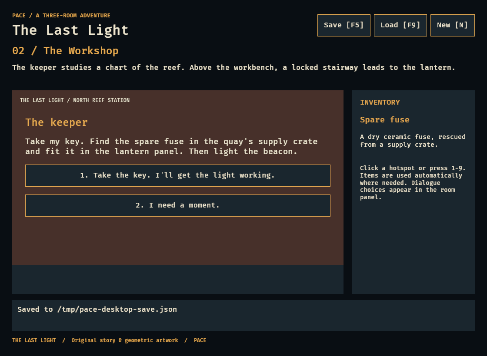
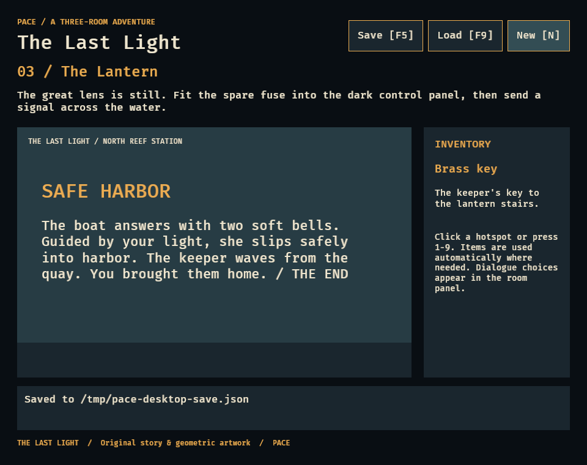

# Play The Last Light

Run `cargo run --locked --features desktop --example last_light` for the native
Bevy game, or `cargo run --locked --example console` for the terminal version.
The same state machine powers both. Assets and dialogue are original; see the
[license](../assets/last-light/LICENSE.md).

Click the labeled hotspots/choices, or use their displayed numbers. Numbering
changes when a one-shot hotspot disappears. All inventory use is automatic.

| Step | Action | Expected result |
| --- | --- | --- |
| 1 | On the quay, Search supply crate | Spare fuse in inventory; crate disappears |
| 2 | Enter workshop | Room changes to workshop |
| 3 | Try Unlock lantern stairs (optional) | Keeper's key is required; no state change |
| 4 | Talk to the keeper | Greeting dialogue opens |
| 5 | Tell me how to fix the light | Instructions node opens |
| 6 | Save (F5), New (N), Load (F9) | Workshop, fuse and active instructions restored |
| 7 | Take the key. I'll get the light working | Key gained; dialogue closes; instructions remembered |
| 8 | Unlock lantern stairs | Room changes to lantern |
| 9 | Try Light the beacon (optional) | Repair is required; no state change |
| 10 | Fit spare fuse | Fuse consumed; repair flag set; panel disappears |
| 11 | Save, New, Load | Lantern, key, repair and dialogue history restored |
| 12 | Light the beacon | Boat reaches safe harbor; THE END |
| 13 | Save, New, Load | Ending restored; further gameplay remains disabled |

You can visit the keeper before collecting the fuse, leave conversations and
return, and travel back to the quay. There is no timer or irreversible failure
in this fixture. On later conversations, the key-taking choice stays exhausted.

## Reproducible demonstration

```sh
cargo run --locked --example console -- --walkthrough
```

This replays [the playable commands](../assets/last-light/walkthrough.txt), writes
real temporary save files, starts fresh games at three checkpoints, compares the
entire restored state, and asserts the ending. It exits unsuccessfully on any
failed action or state mismatch. The temporary slot never replaces a player's
save. [The captured transcript](walkthrough-transcript.txt) shows a complete run.

## Verification

`cargo test --locked` covers invalid scenes, state transitions, blocked and
one-shot actions, dialogue modality/history, pointer hit bounds, Bevy message
ordering, each walkthrough step through a fresh save/load, corrupt/incompatible
saves, file replacement and I/O failure. CI also runs the scripted demonstration
and Clippy on all targets/features, including the desktop player.

The native player was also exercised under Xvfb and Mesa software Vulkan on Linux:
mouse pickup and dialogue choice; keyboard navigation; locked stairs and an
unpowered beacon; F5/F9 and mouse Save/New/Load controls; restored dialogue,
consumed fuse and terminal ending. The 960×760 minimum window was checked for
readable controls. This is a manual native smoke check, separate from CI's
headless tests. Rust 1.99.1 and the locked Bevy 0.20.0 dependency were used.




